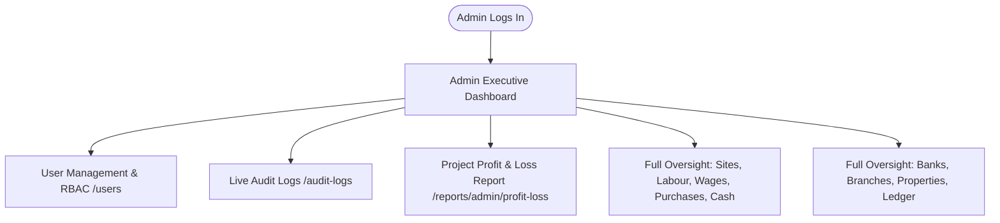
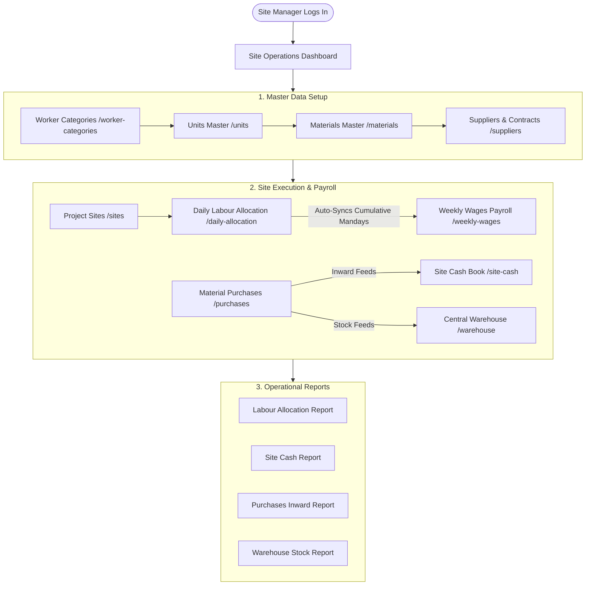
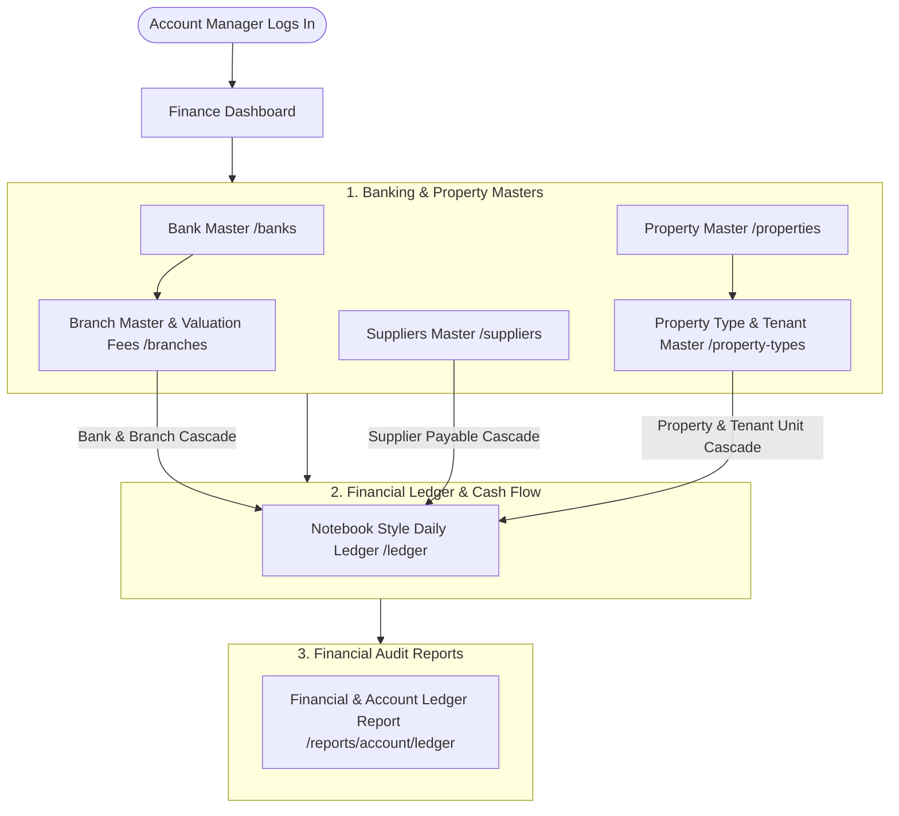
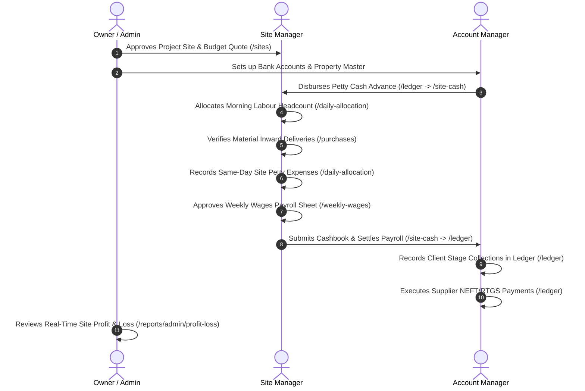

# Deiveni Construction Management System — Application Flow Documentation

> **Application Name:** Deiveni Construction Management System (தெய்வேணி கன்ஸ்ட்ரக்ஷன் மேலாண்மை அமைப்பு)  
> **Framework & Stack:** Laravel 12 (PHP 8.2), MySQL / MariaDB, Bootstrap 5.3, Bootstrap Icons, FontAwesome 6, Plus Jakarta Sans & Noto Sans Tamil  
> **Language Support:** Full Bilingual Interface (English & Tamil — தமிழ்)  
> **Document Purpose:** Complete, updated, step-by-step operational and functional guide detailing every form, field, calculation, and workflow for all user roles: **Owner/Admin**, **Site Manager**, and **Account Manager**.

---

## 1. System Overview & Architecture

**Deiveni Construction Management System** is a purpose-built ERP platform for construction companies, civil contractors, property developers, and valuation professionals. It seamlessly connects three critical operational pillars:

1. **Field Operations (Site Manager):** Daily worker attendance, trade wage allocation, same-day petty expenses, material inward deliveries, weekly wage payroll settlements, and site cash-in-hand tracking.
2. **Financial Accounts & Property Ledgers (Account Manager):** Double-entry daily notebook ledger, bank valuations and branch fee schedules, rental tenant collections, security advances, and supplier payments.
3. **Executive Governance (Owner / Admin):** End-to-end audit surveillance, staff user access controls, and real-time site profitability (Profit & Loss).

```
+-----------------------------------------------------------------------------------------+
|                                    USER INTERFACE                                       |
|  Bootstrap 5.3 + FontAwesome 6 + Plus Jakarta Sans + Noto Sans Tamil (English & தமிழ்)  |
|  Responsive Desktop, Tablet & Mobile Bottom Navigation Bar                              |
|  Dual Data Strategy: Server Database (MySQL) + Client Sync & JSON File Backup/Restore  |
+--------------------------------------------+--------------------------------------------+
                                             | HTTP / AJAX Requests
                                             v
+-----------------------------------------------------------------------------------------+
|                               LARAVEL 12 APPLICATION CORE                               |
|  - Middleware RBAC Protection: `role:owner,admin`, `role:site_manager`, `role:account_manager`
|  - Role Enums & Helpers: `App\Enums\UserRole` with `canAccess()`, `label()`, `badgeClass()`
|  - Service Layer & Controllers: `BranchService`, `SupplierController`, `ReportController`
|  - Eloquent ORM: Users, Banks, Branches, Properties, PropertyTypes, Suppliers, Materials
+--------------------------------------------+--------------------------------------------+
                                             | Database Queries
                                             v
+-----------------------------------------------------------------------------------------+
|                                 MYSQL / MARIADB DATABASE                                |
|  Users & Roles | Worker Categories | Measurement Units | Materials Catalog               |
|  Suppliers & Rate Contracts | Banks & Branches | Properties & Property Units/Rentals    |
+-----------------------------------------------------------------------------------------+
```

---

## 2. User Roles & Permission Matrix (RBAC)

The system enforces strict Role-Based Access Control via `App\Enums\UserRole` and route middleware.

| Module / Page URL | Owner / Admin (`admin`/`owner`) | Site Manager (`site_manager`) | Account Manager (`account_manager`) |
| :--- | :---: | :---: | :---: |
| **Dashboard** (`/dashboard`) | Full Access | Full Access | Full Access |
| **Worker Categories Master** (`/worker-categories`) | Full Access | Full Access | No Access |
| **Units Master** (`/units`) | Full Access | Full Access | No Access |
| **Materials Master** (`/materials`) | Full Access | Full Access | No Access |
| **Suppliers Master & Contracts** (`/suppliers`) | Full Access | Full Access | Full Access |
| **Bank Master** (`/banks`) | Full Access | No Access | Full Access |
| **Branch Master & Valuation Fees** (`/branches`) | Full Access | No Access | Full Access |
| **Property Master** (`/properties`) | Full Access | No Access | Full Access |
| **Property Type & Rental Master** (`/property-types`) | Full Access | No Access | Full Access |
| **Project Sites Management** (`/sites`) | Full Access | Full Access | No Access |
| **Daily Labour Allocation** (`/daily-allocation`) | Full Access | Full Access | No Access |
| **Weekly Wages Sheet** (`/weekly-wages`) | Full Access | Full Access | No Access |
| **Site Cash-in-Hand Book** (`/site-cash`) | Full Access | Full Access | No Access |
| **Material Purchases & Inward** (`/purchases`) | Full Access | Full Access | No Access |
| **Central Warehouse Store** (`/warehouse`) | Full Access | Full Access | No Access |
| **Daily Ledger & Cash Flow** (`/ledger`) | Full Access | No Access | Full Access |
| **Report: Profit & Loss** (`/reports/admin/profit-loss`) | **Exclusive Access** | No Access | No Access |
| **Report: Labour Allocations** (`/reports/site/labour-allocations`) | Full Access | Full Access | No Access |
| **Report: Site Cash Handling** (`/reports/site/cash-handling`) | Full Access | Full Access | No Access |
| **Report: Purchases & Inward** (`/reports/site/purchases-inward`) | Full Access | Full Access | No Access |
| **Report: Warehouse Inventory** (`/reports/site/warehouse-inventory`) | Full Access | Full Access | No Access |
| **Report: Financial Ledger** (`/reports/account/ledger`) | Full Access | No Access | Full Access |
| **User Accounts & RBAC** (`/users`) | **Exclusive Access** | No Access | No Access |
| **Audit Logs & Activity Monitor** (`/audit-logs`) | **Exclusive Access** | No Access | No Access |
| **My Profile & Password Settings** (`/profile`) | Full Access | Full Access | Full Access |

---

## 3. Dedicated User Flow 1: Owner / Administrator (Admin Flow)

### 3.1 Overview & Responsibilities
The Owner / Admin holds complete supervisory authority across the entire business. The Administrator monitors project profitability, manages employee credentials, audits system actions, and can review or edit any master, site operation, or financial record.



---

### 3.2 Admin Form & Module Walkthrough

#### A. Executive Dashboard (`/dashboard`)
- **Key Metrics Shown:**
  - Total Active Construction Sites & Client Headcount
  - Today's Income (Dr), Today's Expense (Cr), and Current Ledger Balance
  - Total Daily Labourers Deployed across all construction sites
  - Warehouse stock value and low-inventory warnings
- **Actions:** Quick links to all operational modules, printable reports, and the quick role switcher for testing view profiles.

#### B. User Accounts & Permission Matrix (`/users`)
- **Purpose:** Create, edit, and control system staff logins and their operational permissions.
- **Form Modal:** "Add System User" (`#userModal`)
  - `User Full Name` *(Required, text)*: Staff member's name (e.g., `Murugan Site Manager`).
  - `Email Address` *(Required, email)*: Unique login identifier (e.g., `sm@deiveni.com`).
  - `Phone Number` *(Optional, text)*: 10-digit mobile contact (e.g., `98400 22222`).
  - `Assigned Role` *(Required, dropdown)*:
    - `Owner (Admin)`: Unrestricted access across all screens.
    - `Site Manager`: Restricts access to field modules, site masters, warehouse, and site reports.
    - `Account Manager`: Restricts access to banks, branches, properties, daily ledger, and financial reports.
  - `Account Status` *(Required, dropdown)*: `Active` or `Suspended`.
  - `Password & Confirm Password` *(Required for new user)*: Minimum 8 characters.
- **Granular Matrix:** Admin can inspect permissions per module (View / Add / Edit / Delete) to ensure strict segregation of duties.
- **Actions Available:** Edit user profile, Reset password directly, Toggle active/inactive status, Delete user.

#### C. Live Audit Logs & Security Activity Monitor (`/audit-logs`)
- **Purpose:** Real-time compliance monitoring tracking all activities across the ERP.
- **Features:**
  - **Live Pulse Indicator:** Blinking indicator showing active live logging stream.
  - **Filter Tabs:** All Logs, Create, Update, Delete, Approval, Cash Handling, Authentication.
  - **Severity Indicators:** `Info` (Blue), `Warning` (Amber), `Critical` (Red).
  - **Side-by-Side Diff Viewer:** Displays previous value vs. updated new value when changes occur.
  - **Log Fields Recorded:** Timestamp, Staff User, IP Address, Action Performed, Target Module, Record ID, and Narration.

#### D. Executive Project Profit & Loss Report (`/reports/admin/profit-loss`)
- **Purpose:** Standalone financial intelligence report exclusive to the Owner/Admin to inspect true commercial performance per project site.
- **Calculations & Columns:**
  1. `Estimated Contract Value (ரூ)`: Agreed budget quote from Project Sites Master.
  2. `Total Client Receipts Received (Dr)`: Sum of all client advances and milestone cash/bank receipts recorded in the Daily Ledger.
  3. `Total Material Expenses (Cr)`: Invoiced purchases and delivery orders inwarded for this site.
  4. `Total Labour & Wage Costs (Cr)`: Cumulative wages paid out through Daily Allocation and Weekly Payroll.
  5. `Same-Day & Local Expenses (Cr)`: Petty site cash expenditures (tea, water cans, local transport).
  6. `Net Project Profit / Loss (ரூ)`:
     $$\text{Net Profit} = \text{Client Receipts} - (\text{Material Costs} + \text{Labour Wages} + \text{Local Expenses})$$
  7. `Profit Margin (%)`:
     $$\text{Profit Margin} = \left(\frac{\text{Net Profit}}{\text{Client Receipts}}\right) \times 100$$
- **Actions:** Filter by active/completed site, Date range filter, 1-click **Export to CSV**, and **Print Profit & Loss Statement**.

---

## 4. Dedicated User Flow 2: Site Manager (Field & Operations Flow)

### 4.1 Overview & Responsibilities
The Site Manager controls all physical ground operations at the construction sites:
- Defining labor trades and base wages
- Registering units, materials, and negotiating supplier rates
- Setting up new project sites and client information
- Entering morning attendance and shift labour counts
- Capturing same-day site petty expenses
- Settling weekly wage sheets
- Managing on-site petty cash balances
- Recording material inward deliveries and receiving tools from central store



---

### 4.2 Site Manager Master Setup Walkthrough

#### 1. Worker Categories Master (`/worker-categories`)
- **Purpose:** Standardize trade classifications, default daily wage amounts, and hourly overtime rates.
- **Form Modal:** "Add Worker Category" (`#categoryModal`)
  - `Category Code`: Auto-generated identifier (e.g., `WC-001`, `CAT-005`).
  - `Category Name (English)` *(Required)*: Trade name in English (e.g., `Brick Mason`, `Head Mestri`, `Bar Bender`, `Carpenter`, `Painter`).
  - `Category Name (Tamil - தமிழ்)` *(Required)*: Tamil translation (e.g., `கொத்தனார்`, `மேஸ்திரி`, `கம்பிகட்டுனர்`, `தச்சர்`, `பெயிண்டர்`).
  - `Daily Base Wage (ரூ)` *(Required, number)*: Standard full-shift rate (e.g., `₹1,100`).
  - `Overtime Rate per Hour (ரூ)` *(Optional, number)*: Hourly overtime rate (e.g., `₹150`).
  - `Status`: `Active` or `Inactive`.
- **Impact:** Automatically populates the trade selection dropdowns in Daily Labour Allocation and Weekly Wages.

#### 2. Units Master (`/units`)
- **Purpose:** Configure construction measurement units for material billing.
- **Form Modal:** "Add Unit" (`#unitModal`)
  - `Unit Name (English)` *(Required)*: e.g., `Metric Ton`, `Bags`, `Brass`, `Loads`, `Square Feet`, `Nos`, `Litres`.
  - `Unit Name (Tamil - தமிழ்)` *(Required)*: e.g., `டன்`, `மூட்டை`, `பிராஸ்`, `லோடு`, `சதுர அடி`, `எண்ணிக்கை`, `லிட்டர்`.
  - `Symbol / Code` *(Required)*: e.g., `MT`, `BAG`, `BRS`, `LOAD`, `SQFT`, `NOS`, `LTR`.
  - `Status`: `Active` or `Inactive`.
- **Impact:** Used in Materials Master, Supplier Price Contracts, Purchases, and Warehouse.

#### 3. Materials Master (`/materials`)
- **Purpose:** Maintain inventory catalog of raw building materials and rental equipment.
- **Form Modal:** "Add Material" (`#materialModal`)
  - `Material Name (English)` *(Required)*: e.g., `Cement (OPC 53 Grade)`, `M-Sand`, `20mm Blue Metal`, `TMT Steel 16mm`.
  - `Material Name (Tamil - தமிழ்)` *(Required)*: e.g., `சிமெண்ட்`, `எம்-சாண்ட்`, `20 மிமீ ஜல்லி`, `கம்பி`.
  - `Category` *(Required, dropdown)*: `Raw Materials`, `Steel & Iron`, `Bricks & Blocks`, `Plumbing & Electrical`, `Paints & Chemicals`, `Rental Machinery / Tools`.
  - `Default Unit` *(Required, dropdown)*: Linked from Units Master (e.g., `Bags`, `Loads`, `Kg`).
  - `Item Code / SKU`: e.g., `MAT-CEM-01`.
  - `Status`: `Active` or `Inactive`.
- **Impact:** Connects supplier price agreements and inward purchase invoices.

#### 4. Suppliers Master & Material Rate Contracts (`/suppliers`)
- **Purpose:** Manage material vendors, hardware stores, machinery rental agencies, and define negotiated unit rates.
- **Form Modal:** "Add Supplier" (`#supplierModal`)
  - `Supplier / Company Name` *(Required)*: e.g., `Chettinad Cement Agency`, `Sri Balaji Blue Metals & M-Sand`.
  - `Contact Person`: e.g., `Mr. K. Ramasamy`.
  - `Mobile Phone` *(Required)*: Primary vendor calling number.
  - `GSTIN Number`: 15-character GST identification code.
  - `Address`: Depot/yard location.
  - `Opening Balance (ரூ)`: Existing ledger payable to supplier.
  - `Status`: `Active` or `Inactive`.
- **Supplier Rate Contract Tab (`/suppliers/{id}`):**
  - Click on any supplier to attach contracted materials with negotiated unit prices (e.g., `Cement OPC 53 @ ₹410 / Bag`, `M-Sand @ ₹8,500 / Load`, `Demolition Breaker Rental @ ₹1,000 / Day`).
- **Impact:** When creating purchases, selecting the supplier auto-loads only their contracted materials and auto-fills agreed unit rates.

---

### 4.3 Site Manager Core Operations Walkthrough

#### A. Project Sites Management (`/sites`)
- **Purpose:** Register and track active construction projects, alteration jobs, client contracts, and overall progress.
- **Header Actions:**
  - `Add New Site` button
  - `Save to File`: Exports entire project site registry to a downloadable `.json` file for offline backup.
  - `Load File`: Imports previously saved site `.json` backup file.
- **Form Modal:** "Create Project Site" (`#siteModal`)
  1. **Site Project Details:**
     - `Site Project Name` *(Required)*: e.g., `Mr. Jayakumar Sir Site`, `Mr. Parthasarathi Sir Site`.
     - `Location / Area` *(Required)*: e.g., `Paarai Pati, Madurai`, `North West Street, Madurai`.
     - `Work Type (பணி வகை)` *(Required, dropdown)*:
       - `New Build (புதிய கட்டுமானம்)`: Ground-up construction projects.
       - `Alteration (சிறு மாற்றம் / புதுப்பித்தல்)`: Renovation, remodeling, or partial structural work.
     - `Start Date` & `End Date`: Contract timeline dates.
     - `Estimated Budget (ரூ)` *(Required)*: Total client project quote (e.g., `₹8,00,000`).
     - `Status`: `In Progress`, `Planning`, `Completed`, `On Hold`.
  2. **Client Details (Radio Switcher):**
     - Option A: **New Client** — Enter new Client Name, Mobile Number, and Postal Address.
     - Option B: **Select Existing Customer** — Dropdown populated with existing registered clients to avoid duplicate client entries.
- **Site Cards View:** Displays progress bar, spent vs. estimated budget, client details, direct quick links to Daily Allocation, Purchases, and Cash Book.

---

#### B. Daily Labour Allocation (`/daily-allocation`)
- **Purpose:** Record daily morning/evening worker headcount per trade category and log same-day site petty expenses. Automatically rolls cumulative attendance and wages into the Weekly Wages sheet.
- **Header Actions:**
  - `Save Daily Allocation`: Commits today's shift to database and local store.
  - `Save to File` / `Load File`: JSON backup and recovery utility.
- **Step 1: Date & Project Site Selection Card:**
  - `Entry Date`: Date picker. Features a dedicated **"Today"** quick select button.
  - `Day Name & Week Badge`: Displays weekday (e.g., `Wednesday`) and wage week cycle.
  - `Project Site Selector`: Dropdown populated with active project sites.
  - **Current Week Working Days Strip:** Interactive buttons from Monday to Saturday.
    > [!IMPORTANT]
    > **Business Rules:**
    > 1. Data entry is strictly allowed for **Today and Previous Dates**.
    > 2. Future dates and Sundays are **disabled / locked** to prevent accidental future entries.
    > 3. Selecting a future date or Sunday displays a yellow **"View-Only Mode"** banner with a quick **"Go to Today"** button.
- **Step 2: Worker Categories & Headcount Allocation:**
  - Click **"Workers Category"** dropdown button to select trade categories:
    - `Head Mason / Lead Mestri (மேஸ்திரி)` — Default rate `₹1,200`
    - `Brick Mason / Plasterer (கொத்தனார்)` — Default rate `₹1,100`
    - `Male Labour Helper (சித்தாள் ஆண்)` — Default rate `₹900`
    - `Female Labour Helper (பெண் சித்தாள்)` — Default rate `₹850`
    - `Bar Bender / Steel Worker (கம்பிகட்டுனர்)` — Default rate `₹1,250`
    - `Carpenter & Centering (தச்சர்)` — Default rate `₹1,350`
    - `Painter / Wall Finisher (பெயிண்டர்)` — Default rate `₹1,100`
    - `Electrician & Plumbing Tech (எலக்ட்ரீஷியன்)` — Default rate `₹1,300`
  - **Table Columns for Each Allocated Trade:**
    - `Worker Category`: English and Tamil trade title.
    - `Daily Wage Rate (தினக்கூலி)`: Default master rate auto-filled; Site Manager can adjust rate for special skills or site conditions.
    - `Worker Count (எண்ணிக்கை)`: Worker headcount stepper with `+` and `-` buttons or direct number input.
    - `Est. Wage (ரூ)`: Automatically computed as:
      $$\text{Trade Subtotal} = \text{Worker Count} \times \text{Daily Wage Rate}$$
    - `Action`: Delete trade row button.
  - **Table Footer:** Displays total worker headcount (e.g., `5 Workers Present`) and cumulative daily labor wage liability.
- **Step 3: Same-Day Site Expenses & Purchases:**
  - Record unexpected minor site expenses incurred on the same shift (e.g., drinking water cans, labor tea/snacks, emergency binding wire).
  - Click **"Add Expense"**:
    - `Expense Description`: e.g., `Water Can (20 Litres)`, `Tea & Morning Snacks`.
    - `Quantity / Hours`: e.g., `2 Cans`.
    - `Unit Price (ரூ)`: e.g., `₹20`.
    - `Final Price (ரூ)`: Automatically calculated.
- **Step 4: Real-Time Financial Summary KPIs:**
  - Total Workers Today
  - Total Daily Labour Wages
  - Same-Day Site Expenses Total
- **Step 5: Historical Day-by-Day Shift Log:**
  - Searchable list of past daily records for this site.
  - Filter by date range.
  - Click any past day to load and view full worker category breakdown or remove duplicate entries.

---

#### C. Weekly Wages Sheet & Settlement (`/weekly-wages`)
- **Purpose:** Aggregate daily labor allocations over Monday-to-Saturday weekly cycles, add weekly lumpsum site expenses, approve payroll settlements, and print worker wage slips.
- **Header Actions:**
  - `Save to File` / `Load File`: JSON backup and export.
  - `Approve & Settle Weekly Wages`: Locks the week's payroll and marks wages as settled.
  - `Go to Daily Allocation`: Direct navigation button if daily shift adjustments are needed.
- **Step 1: Project Site & Wage Week Cycle Navigator:**
  - `Select Project Site`: Dropdown of active construction sites.
  - `Wage Week Cycle`: Week selector dropdown with `< Prev Week`, `Next Week >`, and `Current Week` buttons.
- **Step 2: Day-by-Day Aggregated Table (Read-Only Display):**
  > [!NOTE]
  > Daily shift rows are automatically populated from the Daily Allocation module. Attendance counts, worker categories, and wages are locked to maintain single-source data integrity.
  - **Columns:**
    - `Date & Day`: e.g., `21 Oct 2026 (Wednesday)`.
    - `Worker Category Breakdown`: Summary of trades deployed (e.g., `1 மேஸ்திரி + 2 கொத்தனார் + 2 சித்தாள்`).
    - `Total Labour`: Total workers deployed on that day.
    - `Daily Labour Wage`: Total wage liability for that shift.
    - `Daily Site Expenses`: Same-day water/tea/minor purchases recorded on that shift.
    - `Day Subtotal`: Labour wage + Daily expenses.
    - `Status`: `Recorded` badge.
    - `Details`: Modal preview button displaying full trade-by-trade breakdown.
  - **Table Footer:** Shows total man-days for the week (e.g., `24 Man-Days`), total weekly labor wages, total daily expenses, and cumulative subtotal.
- **Step 3: Additional Weekly Site Expenses Section:**
  - Record non-daily, weekly project expenses (e.g., machinery rental, supervisor travel, generator diesel).
  - Click **"Add Expense"**:
    - `Expense Item`: e.g., `JCB Excavator 4 Hours @ Site A`, `Site Supervisor Travel Allowance`.
    - `Amount (ரூ)`: Entered value.
- **Step 4: Settlement Approval & Wage Slips:**
  - System computes:
    $$\text{Net Weekly Payable} = \text{Cumulative Labour Wages} + \text{Cumulative Daily Expenses} + \text{Additional Weekly Expenses}$$
  - Click **Approve & Settle Weekly Wages** to finalize settlement.
  - Printable wage summary slips in English & Tamil are generated for workers and site records.

---

#### D. Site Cash Handling (`/site-cash`)
- **Purpose:** On-site petty cashbook tracking physical cash-in-hand held by the Site Manager.
- **Header Actions:**
  - `Save to File` / `Load File`: JSON data backup and file reload.
  - `Export Cash Book`: Formatted Excel / CSV ledger export.
  - `Record Cash Transaction`: Opens entry modal (`#cashTransactionModal`).
- **Live Cash Formula Banner:**
  Displays real-time mathematical reconciliation of physical site cash:
  $$\text{Current Cash-in-Hand} = \text{Advance (AM)} + \text{Collections} - \text{Purchases} - \text{Wages} - \text{Returned}$$
- **Transaction Flow Types & Fields in `#cashTransactionModal`:**
  1. `Transaction Flow Type` *(Required, dropdown)*:
     - `Advance Received from AM (+)`: Cash imprest received from Account Manager.
     - `Client Collection on Site (+)`: Cash milestone payment collected directly from project client at site.
     - `Material / Tool Rental Purchase (-)`: Direct cash payment for local hardware or tools.
     - `Supplier Payment (-)`: Cash disbursement against delivered supplier purchase orders.
       > [!TIP]
       > When `Supplier Payment` is selected, a dynamic **"Purchase Order / Invoice"** dropdown appears, filtered exclusively by the selected site! Selecting a Purchase Order displays a preview (Supplier Name, Order Date, Items, Grand Total) and automatically populates the cash amount field.
     - `Daily Worker Wage Payment (-)`: Cash wages disbursed directly to workers on site.
     - `Balance Returned to Account Manager (-)`: Surplus cash returned back to head office.
  2. `Project Site` *(Required)*: Selected site from Project Sites Master.
  3. `Cash Amount (ரூ)` *(Required, number)*: Transaction value.
  4. `Bill / Voucher / Ref No`: Invoice, delivery receipt, or cash voucher number.
  5. `Description / Notes`: Optional transaction narrative.
- **Transaction Table:** Displays date & time, type badge, site, supplier/vendor, bill voucher reference, Inflow (+), Outflow (-), and delete action.

---

#### E. Purchases & Material Inward (`/purchases`)
- **Purpose:** Record supplier deliveries arriving at construction sites, verify delivery challans, and maintain purchase records.
- **Header Actions:**
  - `Materials Master`: Quick jump to material master.
  - `Record New Purchase`: Opens entry modal (`#purchaseModal`).
- **Form Modal:** "Record New Purchase" (`#purchaseModal`)
  - `Purchase Date` *(Required)*: Delivery date.
  - `Bill / Invoice / DC No` *(Required)*: Supplier delivery challan or tax invoice number (e.g., `DC-2026-441`, `INV-2026-881`).
  - `Destination Project Site` *(Required, dropdown)*: Selected project site receiving the materials.
  - `Supplier / Vendor` *(Required, dropdown)*: Selected vendor from Suppliers Master.
  - **Dynamic Multi-Item Row Builder (`#addMaterialUnitRowBtn`):**
    Site Managers can add multiple material line items under a single delivery challan:
    - `Material / Item`: Filtered dropdown displaying only materials contracted with this supplier.
    - `Quantity`: Number of units received.
    - `Unit of Measurement`: Auto-selected based on the material's default unit (Bags, Loads, Kg, Nos, Hours).
    - `Auto-Calculation`:
      $$\text{Item Total} = \text{Quantity} \times \text{Supplier Master Agreed Rate}$$
    - `Action`: Remove line item button.
  - `Total Amount (ரூ)`: Read-only summary summing all dynamic line items.
  - `Delivery Notes / Remarks`: Unloading notes, vehicle number, or weight slip references.
- **Inward Register Table:** Displays bill number, site, supplier contact, material sets, and total amount.
- **Slip Modal:** Clicking "View Details" opens a printable **Material Inward Delivery Slip** with Deiveni Constructions letterhead.

---

#### F. Central Warehouse & Store (`/warehouse`)
- **Purpose:** Monitor owner central depot stock, track hand and power tools, issue materials to sites, and monitor minimum reorder thresholds.
- **Key Metrics Shown:**
  - Total Catalog Items
  - Total Stock Valuation (Current Store Value in ₹)
  - Low Stock Warning Items (Items below reorder threshold)
  - Items Dispatched / Issued Today
- **Core Operations:**
  - **Issue to Site (`#stockMovementModal`):** Select warehouse item, enter quantity, choose destination project site, and record dispatch.
  - **Restock / Inward:** Record new central bulk purchase delivered to warehouse depot.
  - **Add Inventory Item (`#warehouseItemModal`):** Catalog new tools, power equipment, or safety gear with SKU, English/Tamil name, threshold limit, and unit price.

---

### 4.4 Dedicated Site Manager Standalone Reports

All reports are dedicated standalone pages equipped with print and CSV export utilities:

1. **Labour Allocation Report (`/reports/site/labour-allocations`):**
   - Detailed trade-by-trade breakdown across sites (Mestri, Mason, Helper, Carpenter, Painter).
   - Filter by Project Site and Date Range.
   - Summarizes total man-days, overtime hours, and total wage disbursements.

2. **Site Cash Handling Report (`/reports/site/cash-handling`):**
   - Chronological audit of all physical cash movements at site level.
   - Filter by cash flow type (Advances, Collections, Supplier payments, Wages, Returns).
   - Reconciles closing cash in hand.

3. **Purchases Inward Report (`/reports/site/purchases-inward`):**
   - Master delivery inward register.
   - Filter by Supplier, Project Site, and Date Range.
   - Verifies challan numbers, delivered quantities, and bill amounts.

4. **Warehouse Inventory Report (`/reports/site/warehouse-inventory`):**
   - Live inventory status report.
   - Highlights items below reorder thresholds.
   - Details tool deployments across active construction sites.

---

## 5. Dedicated User Flow 3: Account Manager (Finance & Accounts Flow)

### 5.1 Overview & Responsibilities
The Account Manager controls all banking, commercial property rentals, vendor settlements, and company financial journals:
- Managing empanelled banking partners, branch directories, and valuation fee schedules
- Registering owned and leased properties (commercial shops, apartments, offices, sheds)
- Tracking tenant leases, monthly rent schedules, and security deposits
- Maintaining the double-entry Daily Ledger notebook
- Auditing balance carried forward and executing bank reconciliations



---

### 5.2 Account Manager Master Setup Walkthrough

#### 1. Bank Master (`/banks`)
- **Purpose:** Catalog corporate and empanelled banking institutions (e.g., State Bank of India, HDFC Bank, Indian Overseas Bank, Canara Bank).
- **Form Modal:** "Add Bank" (`#bankModal`)
  - `Bank Name (English)` *(Required)*: e.g., `State Bank of India`, `HDFC Bank`.
  - `Bank Name (Tamil - தமிழ்)` *(Optional)*: e.g., `பாரத ஸ்டேட் வங்கி`.
  - `Status`: `Active` or `Inactive`.
- **Impact:** Serves as the parent institution for panel branches in the Branch Master.

#### 2. Branch Master & Valuation Fee Schedules (`/branches`)
- **Purpose:** Manage empanelled bank branches, branch managers, IFSC codes, and agreed standard property valuation inspection fees.
- **Form Modal:** "Add Branch" (`#branchModal`)
  - `Bank Name (வங்கி பெயர்)` *(Required, dropdown)*: Select parent institution from Bank Master.
  - `Branch Name (வங்கி கிளை)` *(Required, text)*: e.g., `Valasaravakkam`, `Porur`, `Guindy`, `Tallakulam`.
  - `Branch Name in Tamil (தமிழ் பெயர்)` *(Optional)*: e.g., `வளசரவாக்கம் கிளை`.
  - `IFSC Code` *(Required, text)*: 11-character alphanumeric IFSC code (e.g., `SBIN0001234`).
  - `Branch Manager / Loan Officer`: Contact person (e.g., `Mr. S. Ramanathan`).
  - `Contact Phone Number`: Manager's phone number.
  - `Standard Valuation Fee (ரூ)` *(Optional, number)*: Empanelled inspection fee schedule (e.g., `₹7,500`).
  - `Status`: `Active` or `Inactive`.
- **Impact:** When recording bank valuation income in the Daily Ledger, choosing the bank dynamically displays its active branches and auto-populates the standard fee.

#### 3. Property Master (`/properties`)
- **Purpose:** Catalog owned or managed real estate assets (commercial complexes, residential apartment blocks, land parcels).
- **Form Modal:** "Add Property" (`#propertyModal`)
  - `Property Name (சொத்து பெயர்)` *(Required)*: e.g., `Deiveni Commercial Complex`, `Lakshmi Enclave Apartments`.
  - `Property Name in Tamil` *(Optional)*: e.g., `தெய்வேணி வணிக வளாகம்`.
  - `Property Type Category`: `Commercial Building`, `Residential Complex`, `Land Parcel`.
  - `Total Units / Shops`: Total count of rentable spaces.
  - `Location / Address`: Physical property address.
  - `Status`: `Active` or `Inactive`.
- **Impact:** Groups rental units in the Property Type Master.

#### 4. Property Type Master & Tenant Leases (`/property-types`)
- **Purpose:** Manage individual rentable units (shops, flats, office suites, sheds), tenant details, monthly rent schedules, and security deposits.
- **Form Modal:** "Add Property Type" (`#propertyTypeModal`)
  - `Select Property (சொத்தின் பெயர்)` *(Required, dropdown)*: Parent property from Property Master.
  - `Shop / Home / Office Name`: Unit title (e.g., `Shop 101 - Ground Floor`, `Flat 2B`, `Shed 4`).
  - `Property Type` *(Required, dropdown)*:
    - `Commercial Shop (வணிகக் கடை)`
    - `Residential Flat (குடியிருப்பு)`
    - `Office Space (அலுவலகம்)`
    - `Warehouse / Shed (கிடங்கு)`
  - `Floor Type (தள வகை)`: e.g., `Ground Floor (GF)`, `First Floor (FF)`, `Second Floor (2F)`.
  - `Location / Address` *(Required)*: Physical location details.
  - `Current Tenant Name`: Full name of tenant / company (e.g., `M/s Royal Travels`, `Dr. S. Kumar`).
  - `Tenant Contact Phone`: Tenant mobile number.
  - `Monthly Rent (மாத வாடகை ரூ)` *(Required, number)*: Agreed rent (e.g., `₹12,000`).
  - `Security Advance (முன்பணம் ரூ)` *(Optional, number)*: Total deposit held (e.g., `₹1,00,000`).
  - `Rent Due Schedule`: Dropdown: `1st of Month`, `5th of Month`, `10th of Month`.
  - `Status`: `Active` or `Inactive`.
- **Impact:** Directly drives the Rental Income entry category in the Daily Ledger.

---

### 5.3 Daily Financial Ledger Walkthrough (`/ledger`)

#### Overview
The Daily Ledger operates as a traditional, notebook-style financial journal. It captures every rupee of company revenue and expenditure, maintaining an unbroken live running balance carried forward day by day.

#### Live Notebook Summary Bar
The top summary bar displays real-time calculations:
1. `Opening Balance Carried Forward (முந்தைய இருப்பு)`: Starting cash/bank balance carried forward from previous period.
2. `Today's Total Income (Dr - மொத்த வரவு)`: Sum of all incoming receipts for the day.
3. `Today's Total Expense (Cr - மொத்த செலவு)`: Sum of all payments and expenses for the day.
4. `Closing Running Balance (கையிருப்பு பேலன்ஸ்)`:
   $$\text{Closing Balance} = \text{Opening Balance} + \text{Total Income (Dr)} - \text{Total Expense (Cr)}$$

#### Form Modal: "Record Daily Ledger Entry" (`#ledgerModal`)
- `Entry Date (தேதி)` *(Required)*: Date of transaction (defaults to today).
- `Entry Flow Type` *(Required, dropdown)*:
  - `Income (Dr - வரவு)`
  - `Expense (Cr - செலவு)`
- `Source / Category` *(Required, dropdown)* with dynamic conditional field cascades:
  1. **Construction (கட்டுமானம்):**
     - Used for client milestone advances or stage payments.
     - Select associated project site (e.g., `Site A - Villa 102`, `Site B - Renovation`).
  2. **Bank Valuation (வங்கி ஆய்வு கட்டணம்):**
     - Dynamic Bank Group displays:
     - `Select Bank`: Select bank from Bank Master.
     - `Select Branch`: Dynamically populates branches belonging to that bank.
     - `Customer / Loan Ref`: Enter customer name or bank loan reference number.
  3. **Rental Income (வாடகை வரவு):**
     - Dynamic Rental Group displays:
     - `Select Property`: Select building from Property Master.
     - `Select Property Type / Unit`: Dynamically populates shop/flat units belonging to that property.
  4. **Supplier Payment (சப்ளையர் செலவு):**
     - Dynamic Supplier Group displays:
     - `Select Supplier`: Choose vendor from Suppliers Master to debit balance.
  5. **Office and Other Expenses (அலுவலக செலவுகள்):**
     - Enter operational expense description (e.g., electricity bill, office stationery, legal fees, internet charges).
- `Amount (ரூ)` *(Required, number)*: Transaction value.
- `Associated Site (Optional)`: Tag transaction to a specific site for project accounting.
- `Description / Narration` *(Required, text)*: Detailed transaction narration.

#### Real-Time Ledger Table
- Displays Date, Description, Source/Category badge, Associated Site, Income (Dr in Green), Expense (Cr in Red), and the **Live Running Balance (ரூ)** after each transaction.
- Filter by Search keyword, Site, Source category, and Flow type (Income vs Expense).

---

### 5.4 Dedicated Account Manager Standalone Report

**Financial & Daily Ledger Report (`/reports/account/ledger`):**
- Standalone accounting statement suitable for internal audit, tax preparation, and chartered accountant verification.
- Instant filters: Date range, Source category, Project site, and Bank account.
- Displays full credit/debit breakdown, opening balance, cumulative inflows, cumulative outflows, and net closing liquidity.
- 1-click **Export to CSV / Excel** and **Print Statement**.

---

## 6. Common User Flow: Profile & Security Settings (`/profile`)

Accessible by all logged-in staff (**Admin**, **Site Manager**, **Account Manager**):

### 6.1 Personal Details Form
- `Full Name`: Update display name.
- `Email Address`: Official email.
- `Phone Number`: 10-digit mobile number.

### 6.2 Password Change Form
- `Current Password` *(Required for verification)*: Ensures account security.
- `New Password`: Minimum 8 characters.
- `Confirm New Password`: Must match new password.

---

## 7. Inter-Role Collaboration Cycle

Here is how the three roles interact during a typical construction project lifecycle:



---

## 8. Daily & Weekly Operational Checklist

### Morning Routine (08:00 AM – 09:30 AM)
- [ ] **Site Manager:** Open `/daily-allocation`, select project site, check the active weekday strip, allocate worker headcount by trade (Masons, Helpers, Carpenters, Steel Workers), and save shift.
- [ ] **Site Manager:** Open `/site-cash`, verify physical cash-in-hand against the live formula banner; if funds are low, request cash top-up.
- [ ] **Account Manager:** Open `/ledger`, check bank balances, disburse approved site petty cash advances.

### Mid-Day Routine (11:00 AM – 02:00 PM)
- [ ] **Site Manager:** Inspect incoming material trucks, verify delivery challans, and record items in `/purchases`.
- [ ] **Account Manager:** Record incoming client milestone receipts, rental collections, and bank valuation fees in `/ledger`.

### Evening Routine (05:00 PM – 06:30 PM)
- [ ] **Site Manager:** Finalize `/daily-allocation` by adding same-day minor purchases (water cans, tea/snacks) and confirm all worker counts.
- [ ] **Site Manager:** Record daily petty cash disbursements in `/site-cash`, ensure balance matches physical cash, and click **Save to File** for local backup.
- [ ] **Account Manager:** Balance the Daily Ledger notebook summary bar (Opening + Dr - Cr = Closing Balance).

### Weekend Routine (Saturday Evening)
- [ ] **Site Manager:** Navigate to `/weekly-wages`, inspect the auto-synced attendance table, add any weekly lumpsum site expenses, and click **Approve & Settle Weekly Wages**.
- [ ] **Owner / Admin:** Open `/reports/admin/profit-loss` to inspect project margin, verify expenses against budget estimates, and review system audit logs in `/audit-logs`.

---

## 9. Form Field Dictionary & Reference Guide

| Module | Form / Modal ID | Field Name | Type | Required? | Purpose / Business Rule |
| :--- | :--- | :--- | :--- | :---: | :--- |
| **User Mgmt** | `#userModal` | `name` | Text | Yes | Staff member full name |
| **User Mgmt** | `#userModal` | `email` | Email | Yes | Login email address (unique) |
| **User Mgmt** | `#userModal` | `role` | Dropdown | Yes | `owner`, `site_manager`, `account_manager` |
| **Worker Categories** | `#categoryModal` | `code` | Text | Auto | Trade code (e.g., `WC-001`, `CAT-005`) |
| **Worker Categories** | `#categoryModal` | `name_en` / `name_ta` | Text | Yes | Bilingual trade name (e.g., Mason / கொத்தனார்) |
| **Worker Categories** | `#categoryModal` | `base_wage` | Number | Yes | Default daily shift wage (e.g., `₹1,100`) |
| **Units Master** | `#unitModal` | `name_en` / `code` | Text | Yes | Measurement name & symbol (`Bags`, `Loads`, `Ton`) |
| **Materials Master** | `#materialModal` | `name_en` / `unit_id` | Dropdown | Yes | Material name linked with default unit |
| **Suppliers** | `#supplierModal` | `name` / `phone` | Text | Yes | Vendor company title & mobile contact |
| **Bank Master** | `#bankModal` | `bank_name` | Text | Yes | Empanelled financial institution name |
| **Branch Master** | `#branchModal` | `bank_id` | Dropdown | Yes | Parent bank linkage |
| **Branch Master** | `#branchModal` | `branch_name` / `ifsc_code`| Text | Yes | Branch location & 11-char IFSC |
| **Branch Master** | `#branchModal` | `valuation_fee` | Number | No | Standard property valuation fee schedule |
| **Properties** | `#propertyModal` | `property_name` | Text | Yes | Complex or building title |
| **Property Types** | `#propertyTypeModal`| `property_id` | Dropdown | Yes | Parent property linkage |
| **Property Types** | `#propertyTypeModal`| `shop_home_office_name`| Text | Yes | Unit title (e.g., `Shop 1`, `Flat 2B`) |
| **Property Types** | `#propertyTypeModal`| `monthly_rent` | Number | Yes | Expected monthly lease rental |
| **Property Types** | `#propertyTypeModal`| `advance_deposit`| Number | No | Security deposit held in custody |
| **Project Sites** | `#siteModal` | `name` / `location` | Text | Yes | Site name and geographical location |
| **Project Sites** | `#siteModal` | `type` | Dropdown | Yes | `New Build` or `Alteration` |
| **Project Sites** | `#siteModal` | `estimate` | Number | Yes | Total client quote / contract budget |
| **Project Sites** | `#siteModal` | `clientOption` | Radio | Yes | Switch between New Client and Existing Client |
| **Daily Allocation** | Date Strip | `dailyAllocDate` | Date | Yes | Entry date (Today & past dates only; future locked) |
| **Daily Allocation** | `#tradeAddDropdown` | Worker Stepper | Stepper | Yes | Headcount allocated per trade category |
| **Daily Allocation** | `#dailyExpensesTable`| Same-Day Expense | Dynamic | No | Water cans, snacks, local emergency items |
| **Weekly Wages** | Weekly Selector | `weeklyCycleSelect` | Dropdown | Yes | Mon-Sat week navigator (Prev/Current/Next) |
| **Site Cash** | `#cashTransactionModal`| `newTxnType` | Dropdown | Yes | Advance, Collection, Purchase, Wages, Return |
| **Site Cash** | `#cashTransactionModal`| `newTxnPurchaseOrder` | Dropdown | No | Auto-filtered by site when paying suppliers |
| **Purchases** | `#purchaseModal` | `purBillNo` / `purSupplier` | Dropdown | Yes | Invoice/DC number and vendor selection |
| **Purchases** | `#purchaseModal` | Multi-Item Rows | Dynamic | Yes | Multiple materials, quantities, units, auto-prices |
| **Daily Ledger** | `#ledgerModal` | `newLedgerFlow` | Dropdown | Yes | `income` (Dr) or `expense` (Cr) |
| **Daily Ledger** | `#ledgerModal` | `newLedgerSource` | Dropdown | Yes | Construction, Bank Valuation, Rental, Supplier, Office |

---

*Updated and maintained for the Deiveni Construction Management System.*
